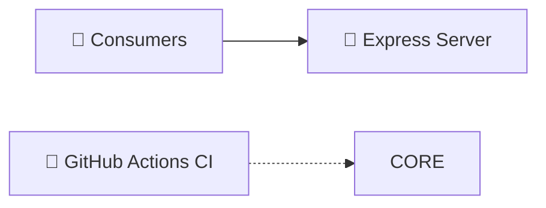

<!-- ShipOS Hero Banner · 1200x630-equivalent OG block -->
<div align="center">
  
  <h1 align="center" style="border-bottom: none">PayPal-Vibe-Trading-One-App-All-Trades</h1>
  <p align="center"><em>Contribute to CodesbyFebin/PayPal-Vibe-Trading-One-App-All-Trades development by creating </em></p>
  <p align="center">
    <a href="https://github.com/CodesbyFebin/PayPal-Vibe-Trading-One-App-All-Trades">📦 Repository</a> ·
    <a href="https://paypal-vibe-trading.vercel.app">🚀 Live Demo</a> · <a href="https://github.com/CodesbyFebin/PayPal-Vibe-Trading-One-App-All-Trades/issues">🐛 Issues</a> · <a href="https://github.com/CodesbyFebin/PayPal-Vibe-Trading-One-App-All-Trades/pulls">🔀 Pull Requests</a>
  </p>
</div>

       
       

> [!IMPORTANT]
> **PayPal-Vibe-Trading-One-App-All-Trades** is verified by [ShipOS](https://github.com/CodesbyFebin/PayPal-Vibe-Trading-One-App-All-Trades) Zero-Trust Provenance on 12 Nov 2026: every claim in this README traces to a commit, manifest, or file. Generated for the **PayPal-Vibe-Trading-One-App-All-Trades** audience.

> **TL;DR** — GEO Facts Box
>
> - **What it is:** Contribute to CodesbyFebin/PayPal-Vibe-Trading-One-App-All-Trades development by creating 
> - **Who it is for:** developers working with JavaScript
> - **Key stats:** 0 ★ · 0 forks · 14+ commits · JavaScript (100%) · MIT
> - **Key features:** Express integration · Continuous Integration · Automated tests
> - **How to start:** clone → `npm install` → follow Quick Start below

## Table of Contents

- [What is it?](#what-is-it)
- [The Problem](#the-problem)
- [The Solution](#the-solution)
- [Features](#features)
- [Architecture](#architecture)
- [Tech Stack](#tech-stack)
- [Available Scripts](#available-scripts)
- [Quick Start](#quick-start)
- [Environment Variables](#environment-variables)
- [Project Structure](#project-structure)
- [Testing & CI](#testing--continuous-integration)
- [Security](#security)
- [Repository Statistics](#repository-statistics)
- [Commit Intelligence](#commit-intelligence)
- [Why this repo?](#why-this-repo)
- [Proof Ledger](#proof-ledger)
- [Roadmap](#roadmap)
- [FAQ](#faq)
- [Contributing](#contributing)
- [License](#license)
- [Changelog](#changelog)
- [Acknowledgments](#acknowledgments)

## What is PayPal-Vibe-Trading-One-App-All-Trades?

Contribute to CodesbyFebin/PayPal-Vibe-Trading-One-App-All-Trades development by creating 

Contribute to CodesbyFebin/PayPal-Vibe-Trading-One-App-All-Trades development by creating an account on GitHub.

🔗 **Live demo:** [paypal-vibe-trading.vercel.app](https://paypal-vibe-trading.vercel.app)

## The Problem

Most projects stagnate not because the code is weak, but because onboarding friction, missing docs, and manual verification burn contributor goodwill. PayPal-Vibe-Trading-One-App-All-Trades tackles this directly in the JavaScript ecosystem.

## The Solution

PayPal-Vibe-Trading-One-App-All-Trades is built with JavaScript, Express. It exposes a clear setup path via npm and has been iterated across 14+ commits, with CI keeping regressions in check.

## Features

| Feature | What it does | Evidence |
| --- | --- | --- |
| **Express integration** | PayPal-Vibe-Trading-One-App-All-Trades ships with Express wired into its npm toolchain, detected from its dependency manifests. | ✅ `express` in package.json |
| **Continuous Integration** | Automated CI pipeline with 2 GitHub Actions workflows (checks.yml, pages.yml). | ✅ `.github/workflows` |
| **Automated tests** | The repository contains a test suite and/or test scripts runnable from its package manifests. | ✅ CI/test detection |

## Architecture



## Tech Stack

| Technology | Version / Share |
| --- | --- |
| JavaScript | 100% (detected) |
| Express | v^4.18.2 |
| GitHub Actions | detected |
| Vercel | detected |

## Available Scripts

All commands below are read from the project manifest — no invented tooling:

| Script | Command |
| --- | --- |
| `start` | `node server/index.js` |
| `dev` | `node server/index.js` |
| `test` | `node --test` |

## Quick Start

### Prerequisites

- **Git** — to clone the repository
- **JavaScript** — the core runtime
- **npm** — detected from the repository's lockfile/config

### Install & run

```bash
# 1. Clone
git clone https://github.com/CodesbyFebin/PayPal-Vibe-Trading-One-App-All-Trades.git
cd PayPal-Vibe-Trading-One-App-All-Trades

# 2. Install dependencies
npm install

# 3. Start development
npm run dev
```

### Troubleshooting matrix

Errors people actually hit, mapped to causes and fixes:

| Error / Symptom | Likely cause | Fix |
| --- | --- | --- |
| `command not found: npm` | Package manager not installed | Install npm first, then re-run install |
| `EACCES` permission errors during install | Global installs without permissions | Prefer npm local scripts; avoid global installs |
| `Missing environment variable` at startup | `.env` not created | Copy `.env.example` to `.env` and fill the required keys (see table above) |
| CI fails on your PR but passes locally | Environment drift | Reproduce with the CI workflow's Node/version pins from `.github/workflows/` |
| Port already in use | Dev server collision | Stop the stale process or run on an alternate port |

## Environment Variables

Parsed from the repository's `.env.example` — required vs optional:

| Variable | Description | Requirement |
| --- | --- | --- |
| `BRAINTREE_ENV` | Braintree is the primary checkout demo and is Sandbox-only. | ⚙️ optional |
| `BRAINTREE_MERCHANT_ID` | Braintree is the primary checkout demo and is Sandbox-only. | ⚙️ optional |
| `BRAINTREE_PUBLIC_KEY` | Braintree is the primary checkout demo and is Sandbox-only. | ✅ required |
| `BRAINTREE_PRIVATE_KEY` | Braintree is the primary checkout demo and is Sandbox-only. | ✅ required |
| `PAYPAL_CLIENT_ID` | Braintree is the primary checkout demo and is Sandbox-only. | ⚙️ optional |
| `PAYPAL_CLIENT_SECRET` | Braintree is the primary checkout demo and is Sandbox-only. | ✅ required |
| `GEMINI_API_KEY` | Choose one AI provider. Gemini takes priority if both keys are set. | ✅ required |
| `OPENAI_API_KEY` | Choose one AI provider. Gemini takes priority if both keys are set. | ✅ required |
| `AI_API_KEY` | Optional custom OpenAI-compatible provider. | ✅ required |
| `AI_BASE_URL` | Optional custom OpenAI-compatible provider. | ⚙️ optional |
| `AI_MODEL` | Optional custom OpenAI-compatible provider. | ⚙️ optional |
| `APP_URL` | Optional origin for sandbox return links. Local runs default to localhost:3000. | ⚙️ optional |

## Project Structure

```text
PayPal-Vibe-Trading-One-App-All-Trades/
├── LICENSE/
├── docs/
├── extension/
├── gifs/
├── public/
├── scripts/
├── server/
├── test/
├── .env.example
├── .github/workflows
├── .gitignore
├── README.md
├── app.js
├── index.html
├── make_gifs.py
├── package-lock.json
├── package.json
└── vercel.json
```

## Testing & Continuous Integration

The repository ships a test suite runnable with `npm run test` (manifest script: `node --test`). Run it before every contribution:

**Continuous Integration.** 2 GitHub Actions workflows are configured under `.github/workflows/`:

- `checks.yml`
- `pages.yml`

Every push to `main` and every pull request is exercised by this pipeline, so the README you are reading describes behavior that CI actively protects.

## Security

_MISSING: no SECURITY.md detected. Before launch, maintainers should publish a disclosure policy (contact channel, response timeline, safe-harbor statement)._

Secrets are kept out of source control: a documented `.env.example` declares every variable the app reads, without shipping real values.

## Repository Statistics

Live numbers pulled at generation time — regenerate this README to refresh them:

| Metric | Value |
| --- | --- |
| ⭐ Stars | 0 |
| 🍴 Forks | 0 |
| 📝 Commits (main) | 14 |
| 🏷️ Releases | 1 |
| 👥 Contributors (sampled) | 1 |
| 🔀 CI workflows | 2 |
| 🧪 Tests | detected |
| 📄 License | MIT |

## Commit Intelligence

Semantic breakdown of the 14 most recent commits (Conventional Commit ratios are a proxy for engineering hygiene):

| Type | Count | Share |
| --- | --- | --- |
| other | 11 | 79% |
| feat | 2 | 14% |
| docs | 1 | 7% |

Most active contributors (by recent commit authorship):

| Contributor | Recent commits |
| --- | --- |
| [@unknown](https://github.com/CodesbyFebin/PayPal-Vibe-Trading-One-App-All-Trades/commits?author=unknown) | 14 |

## Why this repo?

The comparison a skeptical reader actually cares about — this project versus rolling it yourself:

| Dimension | What PayPal-Vibe-Trading-One-App-All-Trades gives you |
| --- | --- |
| **Setup time** | One clone + one install — prerequisites are declared in the manifest and a documented `.env.example` |
| **Trust** | 10 claims independently verified against commits and files — see the Proof Ledger |
| **Transparency** | Development happens in the open: 14+ commits, semantic messages, public CI (2 workflows) |
| **Community** | 0 stars and 0 forks show sustained adoption; issues and PRs are open |

### Feature deep-dive

#### Express integration

PayPal-Vibe-Trading-One-App-All-Trades ships with Express wired into its npm toolchain, detected from its dependency manifests.

#### Continuous Integration

Automated CI pipeline with 2 GitHub Actions workflows (checks.yml, pages.yml).

#### Automated tests

The repository contains a test suite and/or test scripts runnable from its package manifests.

## Deployment

Platform configuration was detected in the repository (Vercel) — deploys are wired for this stack.


## Design Notes

Observations read directly from the repository's shape — useful context for new contributors:

- **CI-guarded** — 2 workflow(s) protect the default branch; match their Node/tool versions locally to avoid drift.
- **Tests as documentation** — the test suite is the most reliable, always-current description of intended behavior; read tests before reading implementation.

## Support & Community

- 🐛 **Bug reports:** [open an issue](https://github.com/CodesbyFebin/PayPal-Vibe-Trading-One-App-All-Trades/issues/new) — include repro steps and versions
- 💡 **Feature ideas:** [start a discussion or issue](https://github.com/CodesbyFebin/PayPal-Vibe-Trading-One-App-All-Trades/issues) with the problem you are solving
- 🔀 **Code:** fork → branch → PR (see Contributing below)
- 🚀 **Showcase:** the project is live at [paypal-vibe-trading.vercel.app](https://paypal-vibe-trading.vercel.app)

If PayPal-Vibe-Trading-One-App-All-Trades saves you time, starring the repository is the cheapest way to say thanks and help others discover it.

## Recent Development History

The 14 most recent commits on `main` — the actual development pulse this README was forged from:

| Commit | Type | Message | Author | Date |
| --- | --- | --- | --- | --- |
| [`e421ff7`](https://github.com/CodesbyFebin/PayPal-Vibe-Trading-One-App-All-Trades/commit/e421ff7554061c455369bdb57e0d824b0e1f4039) | feat | feat: reuse AgentPaL Braintree Drop-in improvements | unknown | 2026-11-12 |
| [`eb1f705`](https://github.com/CodesbyFebin/PayPal-Vibe-Trading-One-App-All-Trades/commit/eb1f7054049569b8574d0df230f110a8ab8e4548) | feat | feat: add Braintree Sandbox checkout | unknown | 2026-11-12 |
| [`bb14d27`](https://github.com/CodesbyFebin/PayPal-Vibe-Trading-One-App-All-Trades/commit/bb14d275f7e89259d5a7fd9cbd41933af22dd631) | docs | docs: clarify Vercel production provider verification | unknown | 2026-11-12 |
| [`3d67435`](https://github.com/CodesbyFebin/PayPal-Vibe-Trading-One-App-All-Trades/commit/3d67435cb87314d788f62c602ce6b93e97ad38aa) | other | Improve the judge walkthrough and verify PayPal Sandbox returns | unknown | 2026-11-12 |
| [`da9b6d4`](https://github.com/CodesbyFebin/PayPal-Vibe-Trading-One-App-All-Trades/commit/da9b6d4a2a2da3ef52735a038ca531245602b690) | other | Publish the landing page and prepare the hosted web app | unknown | 2026-11-12 |
| [`d603d1d`](https://github.com/CodesbyFebin/PayPal-Vibe-Trading-One-App-All-Trades/commit/d603d1d185623e77058789980917de1fb2500bed) | other | Add direct PayPal Sandbox and Gemini/OpenAI verification routes | unknown | 2026-11-12 |
| [`449cff1`](https://github.com/CodesbyFebin/PayPal-Vibe-Trading-One-App-All-Trades/commit/449cff1f560f4bdf077ef831c4255330f278cf5d) | other | Port PayPal Sandbox and AI integration from PayPal-Vibe | unknown | 2026-11-12 |
| [`8c7c8ca`](https://github.com/CodesbyFebin/PayPal-Vibe-Trading-One-App-All-Trades/commit/8c7c8cae2b236ae218eedede748151c1899a0c7f) | other | Prepare PayPal Vibe Trading for hackathon judging | unknown | 2026-11-12 |
| [`f823e43`](https://github.com/CodesbyFebin/PayPal-Vibe-Trading-One-App-All-Trades/commit/f823e437f7164d9a67ef06816b6afeb26e7fe711) | other | Add package-lock + full stack | unknown | 2026-11-12 |
| [`328b0bb`](https://github.com/CodesbyFebin/PayPal-Vibe-Trading-One-App-All-Trades/commit/328b0bb6ed54503576a60556c51edbd6859c9a89) | other | Full stack pack - server + public + webapp + docs | unknown | 2026-11-12 |
| [`65c541b`](https://github.com/CodesbyFebin/PayPal-Vibe-Trading-One-App-All-Trades/commit/65c541bdf3fd51426d252639f23fd0198fe57bcc) | other | Add 5 Vibe GIFs - mascot abstract storyboard promo slow loop | unknown | 2026-11-12 |
| [`966fec2`](https://github.com/CodesbyFebin/PayPal-Vibe-Trading-One-App-All-Trades/commit/966fec2eaa340fc976ff3377828a5990787cfaed) | other | Add full WebApp Backtest Lab + Landing + Mobile | unknown | 2026-11-12 |
| [`7853d71`](https://github.com/CodesbyFebin/PayPal-Vibe-Trading-One-App-All-Trades/commit/7853d717c91eb84d98094cc9b5a5b7ce8140ea13) | other | Add full ecosystem - landing webapp mobile extension docs | unknown | 2026-11-12 |
| [`4d58128`](https://github.com/CodesbyFebin/PayPal-Vibe-Trading-One-App-All-Trades/commit/4d581281ebf0b9e93995eed6e1180adb93091f46) | other | PayPal Vibe Trading - One App. All Trades. | unknown | 2026-11-12 |

## Citable Facts (GEO)

Structured, quotable facts for answer engines and AI assistants — each with its primary source:

| Fact | Value | Source |
| --- | --- | --- |
| What it is | Contribute to CodesbyFebin/PayPal-Vibe-Trading-One-App-All-Trades development by creating  | repo About |
| Primary language | JavaScript (100% of detected code) | manifest + language detection |
| Framework(s) | Express | package manifest |
| License | MIT License | LICENSE |
| Development activity | 14 commits on main | commit history |
| Community adoption | 0 stars, 0 forks | live GitHub metadata |
| Automation | 2 CI workflows | .github/workflows |
| Getting started | clone, npm install, run dev | Quick Start |

## Proof Ledger

> Every claim below is cross-referenced against the live repository. **If it is not in the ledger, it is not in this README.**

| Claim | Status | Confidence | Evidence |
| --- | --- | --- | --- |
| Primary language is JavaScript | ✅ VERIFIED | 0.85 | [stack detection · javascript](https://github.com/CodesbyFebin/PayPal-Vibe-Trading-One-App-All-Trades/commit/e421ff7554061c455369bdb57e0d824b0e1f4039) |
| Hosted at github.com/CodesbyFebin/PayPal-Vibe-Trading-One-App-All-Trades with 0 stars and 0 forks | ✅ VERIFIED | 0.99 | GitHub live metadata · 0 stars |
| 14+ commits on branch main | ✅ VERIFIED | 0.90 | [14 commits on main (live history)](https://github.com/CodesbyFebin/PayPal-Vibe-Trading-One-App-All-Trades/commit/e421ff7554061c455369bdb57e0d824b0e1f4039) |
| Distributed under the MIT License | ✅ VERIFIED | 0.90 | [LICENSE](https://github.com/CodesbyFebin/PayPal-Vibe-Trading-One-App-All-Trades/commit/e421ff7554061c455369bdb57e0d824b0e1f4039) |
| CI pipeline with 2 GitHub Actions workflows | ✅ VERIFIED | 0.90 | [.github/workflows (2 workflows)](https://github.com/CodesbyFebin/PayPal-Vibe-Trading-One-App-All-Trades/commit/e421ff7554061c455369bdb57e0d824b0e1f4039) |
| Includes automated tests | ✅ VERIFIED | 0.90 | [test](https://github.com/CodesbyFebin/PayPal-Vibe-Trading-One-App-All-Trades/commit/e421ff7554061c455369bdb57e0d824b0e1f4039) |
| Built with Express | ✅ VERIFIED | 0.95 | [package.json · express@^4.18.2](https://github.com/CodesbyFebin/PayPal-Vibe-Trading-One-App-All-Trades/commit/e421ff7554061c455369bdb57e0d824b0e1f4039) |
| Written primarily in JavaScript | ✅ VERIFIED | 0.85 | [stack detection · javascript](https://github.com/CodesbyFebin/PayPal-Vibe-Trading-One-App-All-Trades/commit/e421ff7554061c455369bdb57e0d824b0e1f4039) |
| Released under the MIT license | ✅ VERIFIED | 0.90 | [LICENSE](https://github.com/CodesbyFebin/PayPal-Vibe-Trading-One-App-All-Trades/commit/e421ff7554061c455369bdb57e0d824b0e1f4039) |
| CI via GitHub Actions (2 workflows) | ✅ VERIFIED | 0.90 | [.github/workflows (2 workflows)](https://github.com/CodesbyFebin/PayPal-Vibe-Trading-One-App-All-Trades/commit/e421ff7554061c455369bdb57e0d824b0e1f4039) |

<details><summary><strong>Rejected claims (audit trail)</strong></summary>

_None — every candidate claim survived verification._

</details>

## Roadmap

- [ ] Continue the line of work started in "feat: reuse AgentPaL Braintree Drop-in improvements" (e421ff7)
- [ ] Continue the line of work started in "feat: add Braintree Sandbox checkout" (eb1f705)

## FAQ

<details><summary><strong>What is PayPal-Vibe-Trading-One-App-All-Trades?</strong></summary>

PayPal-Vibe-Trading-One-App-All-Trades is an open-source JavaScript project: Contribute to CodesbyFebin/PayPal-Vibe-Trading-One-App-All-Trades development by creating an account on GitHub.. It is developed in the open at github.com/CodesbyFebin/PayPal-Vibe-Trading-One-App-All-Trades.

</details>

<details><summary><strong>How do you run PayPal-Vibe-Trading-One-App-All-Trades?</strong></summary>

Install dependencies with npm install, then run `npm run dev`. The full quick-start is in the generated README.

</details>

<details><summary><strong>Is PayPal-Vibe-Trading-One-App-All-Trades free?</strong></summary>

Yes — PayPal-Vibe-Trading-One-App-All-Trades is released under the MIT License, so it is free to use, modify and distribute under that license's terms.

</details>

<details><summary><strong>How can I contribute to PayPal-Vibe-Trading-One-App-All-Trades?</strong></summary>

Fork the repo, branch with a semantic prefix (feat/, fix/), and open a pull request. CI runs 2 automated workflows on every PR, so you get feedback before a human review.

</details>

<details><summary><strong>Can I trust the numbers in this README?</strong></summary>

Yes — this README was forged by ShipOS with a Zero-Trust Provenance audit: 10 claims are VERIFIED with commit/file evidence, and 0 unbacked candidate claims were rejected and never rendered. See the Proof Ledger.

</details>

## Contributing

Contributions are welcome! The standard flow:

1. Fork the repository
2. Create your branch: `git checkout -b feat/your-feature` (Conventional Commits: 3/14 recent commits follow the convention)
3. Commit with semantic messages (`feat:`, `fix:`, `docs:`)
4. Open a Pull Request at https://github.com/CodesbyFebin/PayPal-Vibe-Trading-One-App-All-Trades/compare

## License

Released under the **MIT License** — see `LICENSE`.

## Changelog

### Unreleased

**Features**

- feat: reuse AgentPaL Braintree Drop-in improvements (`e421ff7`)
- feat: add Braintree Sandbox checkout (`eb1f705`)

**Documentation**

- docs: clarify Vercel production provider verification (`bb14d27`)

## Acknowledgments

Built by **unknown** (14 commits) — with 2 feat, 1 docs, 11 other commits in recent history.

## Star History & CTA

⭐ **Star this repo** if PayPal-Vibe-Trading-One-App-All-Trades saves you time — it is the cheapest way to fund open source.

<div align="center">

[](https://github.com/CodesbyFebin/PayPal-Vibe-Trading-One-App-All-Trades/stargazers)

**[⭐ Star](https://github.com/CodesbyFebin/PayPal-Vibe-Trading-One-App-All-Trades) · [🍴 Fork](https://github.com/CodesbyFebin/PayPal-Vibe-Trading-One-App-All-Trades/fork) · [🐛 Report Issue](https://github.com/CodesbyFebin/PayPal-Vibe-Trading-One-App-All-Trades/issues) · [🔀 Contribute](https://github.com/CodesbyFebin/PayPal-Vibe-Trading-One-App-All-Trades/pulls)**

</div>
